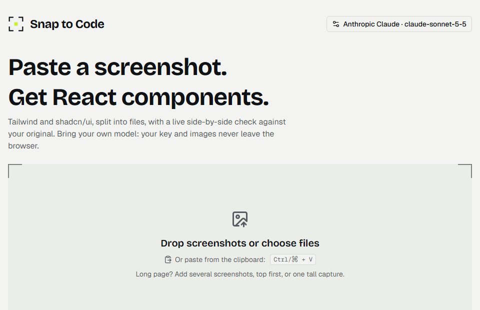

# Snap to Code

Turn a screenshot of a UI into clean **React + Tailwind CSS + shadcn/ui** code, split into components (`Sidebar.tsx`, `Header.tsx`, `DataTable.tsx`, …). Bring your own vision model and API key.

**Live demo: https://snap-to-code.vercel.app**



<sub>The demo was recorded against a local mock model that returns a fixed dashboard, so it shows the interface, not the quality of any real model.</sub>

## What it is, and what it isn't

Snap to Code generates the **look** of one screen: a starting point for the front end that a developer then finishes by hand.

- You get static React components with the same layout, colours and structure, filled with placeholder data.
- You do **not** get a working site: no logic, no forms that submit, no backend, no database, no authentication, no routing between pages.
- Images and logos become placeholders, and fonts, spacing and colours are approximations.
- It builds one page at a time. For a long page, add several screenshots (see *Long pages* below). Simple pages come out well; dense or unusual layouts need more manual work.

Use it on your own designs, mock-ups and sites you have the right to reuse, or to learn from a layout. Do not publish a copy of someone else's site under its own brand, text and images: that can infringe their rights.

## Features

- **Fast input**: paste with `Ctrl/⌘ + V`, drag and drop, or pick files.
- **Long pages**: add several screenshots of one page, or one tall capture. They are stacked top to bottom, and the model receives them as consecutive slices of a single page (see below).
- **Two-step generation**: a vision model first analyses the UI structure (the *Structure* tab), then writes one file per component, streamed live.
- **Code standards**: Tailwind utility classes only, shadcn/ui components, lucide-react icons; `app/page.tsx` composes the page.
- **Before / after compare**: your screenshot and the rendered result side by side with one draggable divider (mouse, touch or arrow keys), so you can see at a glance how faithful the generated UI is.
- **Live preview**: sandboxed iframe with a Desktop / Tablet / Mobile switcher.
- **Export**: copy every file in one click, download a ZIP, or copy the ready-made `npx shadcn@latest add …` command.
- **Bring your own model (BYOK)**: Gemini, OpenAI, Anthropic, OpenRouter, Ollama, or any OpenAI-compatible server.

## Long pages

A page rarely fits in one screenshot. Snap to Code treats everything you add as **one page, top to bottom**:

- **Several screenshots**: paste them one after another (`Ctrl/⌘ + V` each time), pick several files, or press *Add part*. They are stacked in the order you add them. *Undo last* removes the most recent part, *New screenshot* starts over. Up to 8 screenshots.
- **One tall capture** (a full-page screenshot) works too.
- **Slicing**: images sent to the model are at most 1568 px on a side, because larger ones get shrunk by some providers (Claude, for one) until small text is unreadable. A tall page is therefore cut into slices of at most 1568 px that overlap by 48 px, and the model is told they are parts of one page. An ordinary single screenshot, including a phone screenshot, is sent as one image as before.
- **Limits**: a page taller than 12,000 px once scaled is refused with a message; split it into two runs. Every extra slice is extra image tokens, so long pages cost more with paid APIs and run into free-tier limits sooner.
- **Capturing**: scroll in steps of one screen and take a shot at each step. A little overlap between shots is fine and the model is told to ignore repeated rows, but overlap is never removed for you, so avoid large repeats.

## Supported models

Any model that **accepts images** and is reachable through **an API** works. The model name is free text, so new models work the day they ship.

**Chat subscriptions are not API access.** ChatGPT Plus, Claude Pro and similar plans do not come with an API key and cannot be used here. You need an API key from the provider (billed per use), a free-tier key such as Gemini's, or a local model.

| Provider | Protocol | Needs a key | Notes |
| --- | --- | --- | --- |
| Google Gemini | Gemini SDK | yes | Free tier in [Google AI Studio](https://aistudio.google.com/apikey) |
| OpenAI | OpenAI chat completions | yes | |
| Anthropic Claude | Anthropic Messages | yes | Called directly from the browser with Anthropic's browser-access header |
| OpenRouter | OpenAI chat completions | yes | Hundreds of models behind one key |
| Ollama | Ollama `/api/chat` | no | Local. Run `ollama pull qwen2.5vl:7b` |
| **Custom** | OpenAI chat completions | optional | Any server with a base URL: LM Studio, vLLM, llama.cpp, Groq, Together, Mistral, DeepSeek, xAI, LiteLLM, Azure, … |

Not supported: text-only models, services without a public API, and APIs that do not allow browser requests (CORS) and are not OpenAI-compatible. Because requests go straight from your browser to the provider, the provider must allow CORS for the site's origin. Most hosted APIs do; for local servers see below.

### Model names change: the app keeps up

Providers rename and retire models all the time, so no model name is hard-coded as a requirement:

- **Live model list.** With a Gemini, OpenAI, Anthropic or OpenRouter key, the app asks the provider which models the key can use, fills the model suggestions from that list, and, while you have not chosen a model yourself, picks the newest suitable one (for Gemini, the newest stable Flash).
- **Automatic recovery.** If a request fails because the model no longer exists (HTTP 404), the app fetches the list, switches to the best remaining model, tells you, and retries once.
- **Your choice wins.** A model you typed or picked is never replaced behind your back; only the recovery above can change it, and only after the provider has refused it.
- **Fallback.** The built-in suggestions in `src/lib/providers.ts` are used only when the list cannot be fetched. Keep them roughly current, but nothing breaks when they are not.

### Ollama and other local servers

```bash
ollama pull qwen2.5vl:7b
# Needed only when using a deployed (HTTPS) copy of this app:
OLLAMA_ORIGINS="*" ollama serve
```

Local models are noticeably weaker than hosted ones; complex layouts usually need a stronger model.

## Privacy

The app is fully client-side and has no backend. API keys live in your browser's `localStorage` (one profile per provider) and are sent only to the provider you choose. Images go straight to that provider too.

## Security

Generated code is untrusted: text inside a screenshot can steer the model.

- **Sandboxed preview**: `iframe sandbox="allow-scripts"` without `allow-same-origin`, with a CSP of `connect-src 'none'` (code cannot send data out) and scripts only from three CDNs, four of them pinned with SRI hashes.
- **Code scanner**: warns about `fetch`, `eval`, `dangerouslySetInnerHTML`, storage access and imports outside an allow-list. It is a heuristic, not a guarantee: always review the code.
- **File paths** returned by the model are sanitised (no `..`, no absolute paths) so a ZIP cannot write outside its extraction folder.
- **API keys** sit in `localStorage`. If the provider supports it, restrict the key to your site's domain (HTTP referrer).
- Response headers: `X-Frame-Options`, `nosniff`, `Referrer-Policy`, `Permissions-Policy`.

## Getting started

```bash
npm install
npm run dev
```

Open http://localhost:3000, paste an API key, then paste a screenshot. That is the whole setup:

- **Paste a key and go.** The provider is detected from the key (`AIza…` Gemini, `sk-ant-…` Anthropic, `sk-or-…` OpenRouter, `sk-…` OpenAI) and a sensible default model is chosen. Provider, base URL and model live under *Advanced settings*.
- **No key at all?** If Ollama or LM Studio is running with a vision model, the app finds it on first launch (on `localhost` only) and uses it. On a deployed site, press *Find local models* in Advanced settings.

```bash
npm test        # unit and protocol tests
npm run lint
npm run build
```

## Deploy

Push to GitHub and import the repo in Vercel. No environment variables are needed.

## How it works

| File | Role |
| --- | --- |
| `src/lib/pipeline.ts` | orchestration: analyse, then generate |
| `src/lib/providers.ts` | provider presets, config validation |
| `src/lib/llm.ts` | streaming clients for the four protocols, straight from the browser |
| `src/lib/sse.ts` | Server-Sent Events reader and per-protocol delta parsers |
| `src/lib/prompts.ts` | system prompts and code rules |
| `src/lib/parse.ts` | parses the JSON analysis and `=== FILE: path ===` blocks |
| `src/lib/scan.ts` | heuristic scanner for suspicious generated code |
| `src/lib/preview-html.ts` | preview runtime: Babel plus small shadcn/lucide stand-ins inside the iframe |
| `src/lib/export.ts` | copy, ZIP, detection of the shadcn components needed |

## Limitations

- The preview uses simplified shadcn/ui components (Button, Card, Table, Tabs, …). Complex ones (dropdown, dialog) render as plain blocks. It loads Tailwind and React from a CDN, so it needs internet access.
- Output quality depends on the model. Review the code before using it.

## Roadmap

Planned: automatic correction by comparing the render with the screenshot, editing by instruction, separate models for reading and for writing code, and a model trained for this task. See [ROADMAP.md](ROADMAP.md).

## License

[MIT](LICENSE)
